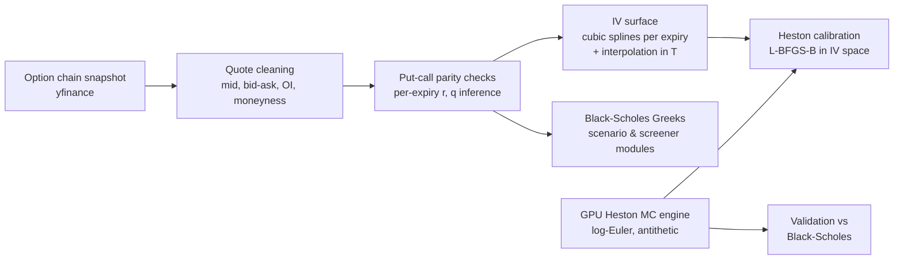

# Heston Option Pricing — Market Data to GPU Monte Carlo Calibration

[](https://colab.research.google.com/github/aravshanghavi/heston_option_pricing/blob/main/Heston.ipynb)


An end-to-end equity-options research pipeline in a single notebook: it ingests a listed option chain, cleans quotes, checks put–call parity, builds a smoothed implied-volatility surface, prices options under the **Heston (1993) stochastic-volatility model** with a **GPU Monte Carlo engine**, validates that engine against Black–Scholes, and calibrates the five Heston parameters **(κ, θ, σ, ρ, v₀)** to a market smile in implied-volatility space.

The reference run uses **AAPL** options (spot S₀ = 262.82, October 2025 snapshot) on a **Tesla T4** GPU in Google Colab.

---

## Table of Contents

1. [Pipeline](#pipeline)
2. [Methodology](#methodology)
3. [Results (reference run)](#results-reference-run)
4. [Getting Started](#getting-started)
5. [Outputs](#outputs)
6. [Notebook Map](#notebook-map)
7. [References](#references)
8. [License](#license)

---

## Pipeline



---

## Methodology

### 1. Market data ingestion and cleaning

- Pulls a point-in-time option-chain snapshot and spot price through `yfinance` (Yahoo Finance).
- Expiry selection by time to maturity (reference run: 0.03 ≤ T ≤ 0.60 years, ACT/365.25).
- **Bid–ask cleaning:** mid = (bid + ask)/2 when a two-sided quote exists, otherwise last trade; the reference price is the mid **clipped to [bid, ask]**.
- **Liquidity / sanity filters:** positive mid, open interest > 0, moneyness K/S₀ ∈ [0.7, 1.3], quoted IV clamped to [1%, 250%].
- **Repricing check:** each contract is repriced by Black–Scholes from its quoted IV and compared with the reference price.

### 2. Put–call parity and implied carry

For each expiry, matched call/put pairs are regressed as

$$C - P = DF\cdot F - DF\cdot K$$

to back out the discount factor $DF$ and forward $F$, which give per-expiry implied rate and carry:
$r = -\ln(DF)/T$, $q = r - \ln(F/S_0)/T$. Parity residuals are recomputed with the inferred (r, q).

### 3. Implied-volatility surface

- Per expiry: a **cubic smoothing spline** (`scipy.interpolate.UnivariateSpline`, k = 3) of IV against moneyness, with a linear-spline fallback.
- Across maturities: the per-expiry fits are interpolated onto a (T × K/S₀) grid with cubic `griddata`, producing 3-D and contour views of the surface.

### 4. Heston Monte Carlo engine (PyTorch, CUDA)

Risk-neutral dynamics:

$$dS_t = (r-q)\,S_t\,dt + \sqrt{v_t}\,S_t\,dW^S_t,\qquad dv_t = \kappa(\theta - v_t)\,dt + \sigma\sqrt{v_t}\,dW^v_t,\qquad d\langle W^S, W^v\rangle_t = \rho\,dt$$

- **Log-Euler** discretisation for $X_t = \ln S_t$:
  $X_{t+\Delta t} = X_t + (r - q - \tfrac12 v_t)\Delta t + \sqrt{v_t}\,\Delta W^S_t$
- **Variance — full truncation** (Lord, Koekkoek & van Dijk, 2010): the Euler variance state is carried forward unfloored, and $v_t^+ = \max(v_t, 0)$ is used in the drift, the diffusion and the log-spot step:
  $\hat v_{t+\Delta t} = \hat v_t + \kappa(\theta - \hat v_t^+)\Delta t + \sigma\sqrt{\hat v_t^+}\,\Delta W^v_t$
- **Correlated shocks:** $\Delta W^S = \sqrt{\Delta t}\,(\rho Z_1 + \sqrt{1-\rho^2}\,Z_2)$.
- **Antithetic variates:** every normal draw is paired with its negation.
- Fully vectorised over paths on the GPU; very large runs are **batched** (1.5M paths per batch) to stay within T4 memory.
- European payoffs are discounted at $e^{-rT}$; a vectorised pricer values a full strike grid from one path set.

### 5. Greeks

- **Black–Scholes Greeks** (Δ, Γ, vega, Θ, ρ) for every contract in the cleaned chain.
- **Monte Carlo Greeks:**
  - Pathwise delta, $\Delta = e^{-rT}\,\mathbb{E}\big[\mathbf{1}_{\{S_T>K\}}\,S_T/S_0\big]$ (valid under Heston, since $S_T$ is homogeneous of degree one in $S_0$).
  - Pathwise vega for the σ = 0 (Black–Scholes) limit, used for engine validation.
  - Heston vega by finite difference in $v_0$ with **common random numbers**, reported per unit of initial volatility $\sqrt{v_0}$.

### 6. Validation against Black–Scholes

Setting σ = 0 and v₀ = θ collapses Heston to Black–Scholes with volatility $\sqrt{v_0}$. The MC price, pathwise delta and pathwise vega are compared against closed-form values, with batched runs of up to **201M paths** (134 × 1.5M).

### 7. Calibration in implied-volatility space

- **Target:** the smoothed smile (120 points) at a single 3–9-month expiry.
- **Objective:** sum of squared differences between Heston-MC implied vols (prices inverted with Brent's method) and target implied vols.
- **Optimiser:** `scipy.optimize.minimize`, **L-BFGS-B** with box constraints:
  κ ∈ [0.1, 10], θ ∈ [0.01, 1], σ ∈ [0.01, 2], ρ ∈ [−0.99, −0.1], v₀ ∈ [0.01, 1].
- Each objective evaluation runs 50K antithetic paths × 100 steps with a **fixed seed** (common random numbers), making the objective deterministic for finite-difference gradients. Failed IV inversions are penalised.

### 8. Additional analytics

- Scenario repricing under spot / volatility / time shocks, including spot × vol P&L heatmaps at 0, +1 and +5 days.
- A transparent contract screener ranking options by delta-per-dollar, vega-per-dollar and relative spread (heuristic; not backtested).

---

## Results (reference run)

Figures below are from the October 2025 reference run (AAPL, S₀ = 262.82, Tesla T4). Because the notebook pulls live data, a re-run on another date will produce different numbers.

### Data quality

| Metric | Value |
|---|---|
| Contracts after filtering | 490 across 10 expiries |
| Matched call/put parity pairs | 212 |
| BS repricing error from quoted IV (r = q = 0): mean / median | $0.156 / $0.062 |
| Median parity residual: r = q = 0 → per-expiry inferred (r, q) | $1.50 → $0.011 |
| Contracts passing repricing-error < $1 and spread < 30% of mid | 308 of 490 |

### Monte Carlo engine vs. Black–Scholes (ATM, T = 1y, vol = 20%)

| Quantity | Analytical | Monte Carlo | Abs. difference | Paths |
|---|---|---|---|---|
| Call price | 28.182594 | 28.188133 | 0.005539 | 200K |
| Delta (pathwise) | 0.654239 | 0.654241 | 0.000003 | 201M (batched) |
| Vega (pathwise, per 1.00 vol) | 101.587301 | 101.600547 | 0.013246 | 201M (batched) |

Throughput: 100K paths × 252 daily steps (T = 1y) simulated in **0.15 s** on a T4.

---

## Getting Started

### Option A — Google Colab (recommended)

1. Click **Open in Colab** above.
2. Select **Runtime → Change runtime type → GPU**.
3. Run all cells in order. The ticker and filters are set in the "RUN ENGINE" cell (`ticker = "AAPL"`).

### Option B — Local

```bash
git clone https://github.com/aravshanghavi/heston_option_pricing.git
cd heston_option_pricing
pip install yfinance pandas numpy scipy matplotlib torch jupyter
jupyter notebook Heston.ipynb
```

A CUDA-capable GPU is strongly recommended. The engine falls back to CPU, but the 201M-path validation cells are impractical without a GPU (≈ 6 minutes per batched loop on a T4). Package versions are not pinned.

---

## Outputs

Running the notebook writes the following to the working directory (not committed to the repository):

| Path | Contents |
|---|---|
| `AAPL_surface.csv` | Cleaned, calibration-ready option chain |
| `figures_prelim/` | IV smiles with bid/ask IV bands, mid-price curves, parity residuals, liquidity heatmap, IV term structure, raw IV surface |
| `figures_risk/` | Delta by strike, gamma heatmap, vega by moneyness, theta ladder |
| `figures_surface/` | Per-expiry spline fits, 3-D and contour IV surfaces |
| `figures_scenarios/` | Scenario P&L bars and spot × vol heatmaps |
| `figures_trade/`, `trade_picks.csv` | Screener rankings |
| `figures_heston/` | Sample Heston spot and variance paths |
| `figures_calibration/` | Calibrated Heston smile vs. market and target smiles |
| `run_report/README.md` | Run summary |

---

## Notebook Map

| Stage | What it does |
|---|---|
| Setup | Installs/imports, GPU memory utilities |
| Data | `build_option_dataset` — chain ingestion, cleaning, filters |
| Validation | `validate_dataset`, `infer_r_q_per_expiry`, `apply_r_q_and_check` |
| Diagnostics | Publication-style plots of smiles, spreads, parity, term structure |
| Greeks | Black–Scholes Greeks and risk charts |
| Surface & scenarios | Spline IV surface, scenario repricing |
| Screener / scenario grid / report | Ranked contracts, P&L heatmaps, run report |
| Heston MC | `simulate_heston_paths`, `price_heston_mc` |
| MC validation | Price, delta and vega vs. Black–Scholes |
| Calibration | IV-space objective, L-BFGS-B, model-vs-market plot |

---

## References

- Heston, S. L. (1993). *A Closed-Form Solution for Options with Stochastic Volatility with Applications to Bond and Currency Options.* Review of Financial Studies, 6(2), 327–343.
- Lord, R., Koekkoek, R., & van Dijk, D. (2010). *A comparison of biased simulation schemes for stochastic volatility models.* Quantitative Finance, 10(2), 177–194.
- Glasserman, P. (2003). *Monte Carlo Methods in Financial Engineering.* Springer.
- Gatheral, J. (2006). *The Volatility Surface: A Practitioner's Guide.* Wiley.

---

## License

Released under the [Apache License 2.0](LICENSE).
